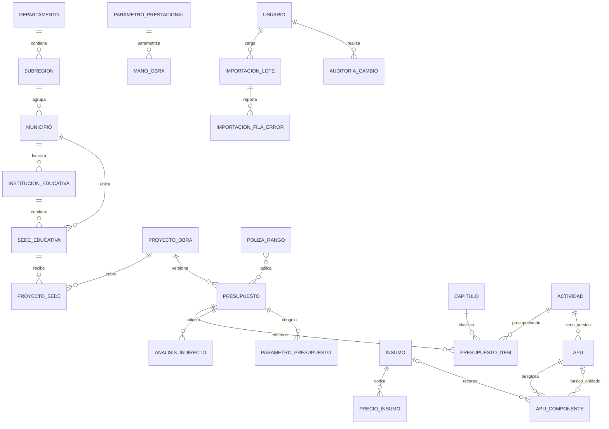

# SKILL.md — Aplicación de presupuesto de obra pública para infraestructura educativa de Caldas

## 1. Propósito y rol

Actúa como arquitecto de software, analista de datos y desarrollador full-stack con experiencia en presupuestos de construcción, infraestructura educativa, geografía administrativa colombiana y contratación pública.

Desarrolla una aplicación web para formular, administrar, comparar y auditar presupuestos de obra pública asociados a la infraestructura educativa del departamento de Caldas. La estructura territorial y educativa debe permitir consultar y presupuestar por:

**Departamento → Subregión → Municipio → Institución Educativa → Sede Educativa → Proyecto/Intervención → Presupuesto → Capítulos → Actividades/Ítems.**

La fuente inicial es el libro `BASE DE DATOS 2026_S2_SV.xlsm`. Debe tratarse como fuente de datos y reglas por verificar, no como especificación infalible. Conserva el archivo original sin modificarlo.

## 2. Alcance territorial y funcional

La aplicación debe permitir:

- Administrar el catálogo de subregiones de Caldas.
- Administrar municipios y su asociación con una subregión.
- Administrar instituciones educativas y sus sedes.
- Asociar cada sede a su institución y municipio; validar consistencia territorial.
- Registrar proyectos o intervenciones en una o varias sedes, con tipo de obra, alcance, fechas, estado, responsable y fuente de financiación.
- Crear varios presupuestos/versiones para un proyecto.
- Estructurar el presupuesto por capítulos, actividades, unidades, cantidades, precios unitarios y subtotales.
- Consultar costos y necesidades por subregión, municipio, institución y sede.
- Administrar cantidades, precios y parámetros de cálculo individualmente o mediante operaciones masivas.
- Importar y exportar Excel, con plantillas descargables, validación previa, reporte de errores y resumen de filas procesadas.
- Mantener precios y parámetros históricos por vigencia y evitar que una actualización cambie silenciosamente presupuestos aprobados.
- Generar presupuesto detallado, resumen por capítulo, análisis de precios unitarios (APU), consolidado por territorio, institución y sede, e informes exportables a Excel/PDF.
- Controlar permisos por rol, auditoría, aprobación y trazabilidad de cambios.
- Comparar escenarios, vigencias y versiones de presupuesto.

## 3. Inspección del Excel antes de construir

Inspecciona todas las hojas, encabezados, fórmulas, celdas combinadas, rangos con nombre, tablas, validaciones y filas ocultas del libro. El archivo contiene, como mínimo, las siguientes hojas identificadas:

| Hoja | Uso inicial identificado |
|---|---|
| `Capitulos` | Catálogo de capítulos/categorías. |
| `Actividades` | Catálogo de actividades y precios unitarios de referencia. |
| `A.P.U` | Componentes y cálculos de análisis de precios unitarios. |
| `Insumos` | Recursos, unidades, precios, fuentes y observaciones. |
| `Analisis AU` | Estructura de gastos generales/indirectos. |
| `Analisis Mano de Obra` | Cálculos de mano de obra y cuadrillas. |
| `Analisis Herramienta Menor` | Parámetros/cálculos de herramienta menor e IVA. |
| `Analisis Factor Prestacional` | Factores laborales/prestacionales. |
| `Polizas` | Rangos y valores de referencia de pólizas. |

Estas hojas deben perfilarse antes de definir la importación definitiva. Pueden existir filas de título, búsquedas, fórmulas, subtotales, celdas vacías o combinadas. No interpretes cada fila como un registro ni reemplaces fórmulas sin entender su propósito.

### Entregables de la fase de análisis

1. Inventario de hojas, tablas, rangos, columnas y fórmulas.
2. Diccionario fuente con nombre de hoja, columna, significado, tipo observado y regla de transformación.
3. Identificación de claves naturales, duplicados, referencias rotas, unidades heterogéneas y campos calculados.
4. Matriz de trazabilidad `hoja/columna Excel → entidad/campo de destino`.
5. Registro de reglas confirmadas, reglas inferidas y preguntas pendientes para validación funcional.

## 4. Roles de usuario

- **Administrador:** usuarios, permisos, catálogos territoriales y parámetros globales.
- **Administrador de costos:** insumos, precios, mano de obra, factores, pólizas y reglas de cálculo.
- **Formulador:** proyectos, cantidades, ítems y presupuestos.
- **Revisor:** verifica estructura, precios, cantidades, soportes y consistencia.
- **Aprobador:** aprueba y congela versiones de presupuesto.
- **Consulta/analista:** visualiza consolidados y descarga informes sin editar datos.
- **Auditor:** consulta historial, importaciones y decisiones de aprobación.

Aplicar mínimo privilegio y verificar autorización en servidor, no solo ocultar controles en la interfaz.

## 5. Administración individual y masiva

Toda entidad editable debe tener una opción de edición individual y, cuando sea razonable, una operación masiva.

### 5.1 Edición individual

- Formularios con campos obligatorios, unidades, vigencia, fuente y validación contextual.
- Vista previa del impacto del cambio sobre los presupuestos no aprobados.
- Confirmación antes de ejecutar acciones que afecten varios registros.
- Historial con valor anterior, valor nuevo, usuario, fecha, motivo y archivo fuente si aplica.

### 5.2 Edición masiva

Implementar un flujo común para cantidades, precios y parámetros:

1. Descargar plantilla con identificadores estables, nombres de columna y ejemplo.
2. Cargar XLSX/CSV y elegir hoja o tipo de importación.
3. Mapear columnas si la plantilla no es la estándar.
4. Validar tipos, campos requeridos, unidades, vigencia, duplicados, claves foráneas, rangos y permisos.
5. Mostrar previsualización y resumen: válidos, inválidos, nuevos, actualizados y sin cambios.
6. Permitir descargar el detalle de errores con número de fila, campo, valor recibido y motivo.
7. Solicitar confirmación expresa antes de aplicar cambios.
8. Ejecutar transaccionalmente: si una operación atómica falla, revertirla; para cargas grandes, usar lotes con estado y reanudación controlada.
9. Generar informe de resultado e identificador de importación.
10. Guardar auditoría y permitir rastrear los registros afectados.

No actualizar registros por descripción solamente. Usar ID estable o clave natural validada. Definir explícitamente si cada carga **crea**, **actualiza**, **sincroniza** o **solo valida**; nunca inferir el modo.

## 6. Reglas de cálculo presupuestal

Todas las fórmulas deben implementarse en una capa de dominio compartida y probarse con casos del Excel.

- Parcial del componente de APU: `rendimiento × precio unitario aplicado`.
- Precio unitario de APU: suma de los parciales de componentes que correspondan a la estructura validada.
- Subtotal del ítem: `cantidad de obra × precio unitario`.
- Costo directo del presupuesto: suma de subtotales de ítems.
- Costos indirectos/AIU: calcular según componentes y factores configurados y aprobados para el presupuesto.
- Total presupuestal: costo directo más indirectos y demás conceptos aprobados que apliquen.
- IVA, herramienta menor, mano de obra, factor prestacional, pólizas, impuestos, estampillas y redondeos deben identificarse por separado cuando corresponda. Evitar doble contabilización de valores ya incluidos en insumos.
- No fijar porcentajes universales para AIU, IVA, pólizas ni factores laborales. Deben provenir de parámetros con vigencia, fuente, fecha de aprobación y responsable.
- Usar tipos decimales exactos en almacenamiento y cálculo monetario; no usar coma flotante binaria para dinero.
- Definir la regla de redondeo por concepto y momento de cálculo, documentarla y aplicarla consistentemente.
- Los presupuestos aprobados deben conservar una instantánea de precios, cantidades, parámetros y componentes de APU utilizados.
- Toda cifra debe ser reproducible con la versión de cálculo y los parámetros históricos registrados.

## 7. Modelo de datos propuesto

El siguiente modelo es lógico y preliminar. Validar nombres, tipos y relaciones con el perfilamiento del Excel y con los catálogos oficiales de educación y división territorial que entregue el responsable del sistema.

### 7.1 Entidades territoriales y educativas

- `departamento`: código DANE, nombre.
- `subregion`: código, nombre, departamento.
- `municipio`: código DANE, nombre, subregión.
- `institucion_educativa`: código DANE/identificador oficial, nombre, municipio, estado.
- `sede_educativa`: código DANE de sede, nombre, institución, municipio, dirección/vereda, zona, estado. Validar que el municipio de la sede sea consistente con la institución, permitiendo excepciones documentadas si el sistema real las contempla.

### 7.2 Presupuesto y estructura de obra

- `proyecto_obra`: código, nombre, tipo de intervención, objeto, sede o alcance multi-sede, fechas, estado, responsable y financiación.
- `proyecto_sede`: tabla puente para asociar un proyecto a una o varias sedes, con alcance o distribución por sede.
- `presupuesto`: proyecto, número de versión, vigencia, estado, moneda, parámetros y totales congelados al aprobar.
- `capitulo`: código, descripción y orden.
- `actividad`: código, descripción, unidad, categoría y estado.
- `presupuesto_item`: presupuesto, capítulo, actividad, cantidad, precio unitario aplicado, subtotal y orden.
- `apu`: actividad, versión, unidad, fecha de vigencia y estado.
- `apu_componente`: APU padre, tipo de componente, insumo o APU básico referenciado, rendimiento, unidad, precio aplicado y costo parcial.
- `insumo`: código, descripción, tipo, unidad, fuente y observaciones.
- `precio_insumo`: insumo, precio, vigencia, fecha, fuente, inclusión de IVA, versión y estado.
- `mano_obra`: ocupación/cuadrilla, unidad y tarifa o costo horario.
- `parametro_prestacional`: concepto, condición, rango, valor/factor, vigencia y fuente.
- `parametro_presupuesto`: concepto, valor, unidad, fórmula/tipo, vigencia, fuente, fecha de aprobación.
- `analisis_indirecto`: concepto, cantidad, dedicación, valor unitario, factor y total por presupuesto.
- `poliza_rango`: tipo de póliza, límites, tasa/valor, vigencia y fuente.

### 7.3 Importaciones, permisos y auditoría

- `importacion_lote`: usuario, archivo, hash, tipo, modo, fecha, estado, resumen y errores.
- `importacion_fila_error`: lote, fila de origen, campo, valor recibido y descripción del error.
- `auditoria_cambio`: usuario, fecha, entidad, ID afectado, campo, valor anterior/nuevo, motivo y lote relacionado.
- `usuario`, `rol`, `usuario_rol` y, si se requiere autorización granular, `permiso`.

## 8. Diagrama entidad-relación

Notas del modelo:
- `PROYECTO_SEDE` es necesaria para proyectos que cubran varias sedes.
- Si cada proyecto solo puede pertenecer a una sede, puede simplificarse, pero la tabla puente ofrece mayor flexibilidad.
- El enlace de `APU_COMPONENTE` a `INSUMO` o a otro APU debe ser excluyente según el tipo de componente. Implementar una restricción de integridad para impedir que ambos estén informados a la vez o que ambos sean nulos.
- Prevenir ciclos en APU anidados.
- La asignación de institución y sede debe conservar códigos oficiales y permitir actualizar nombres sin perder la identidad histórica.
- Los catálogos territoriales deben cargarse de una fuente validada por el administrador; no codificar una lista estática dentro del programa.

## 9. Diccionario de datos inicial

Tipos SQL orientativos; adaptar a PostgreSQL, SQL Server u otra base aprobada. Usar `DECIMAL` para cantidades y dinero y `VARCHAR` para códigos oficiales.

| Tabla | Campo | Tipo sugerido | Reglas |
|---|---|---|---|
| `departamento` | `id` | BIGINT PK | Identificador interno. |
| `departamento` | `codigo_dane` | VARCHAR(2) UNIQUE | Código oficial como texto. |
| `departamento` | `nombre` | VARCHAR(100) | Obligatorio. |
| `subregion` | `id` | BIGINT PK | Identificador interno. |
| `subregion` | `departamento_id` | BIGINT FK | Departamento al que pertenece. |
| `subregion` | `codigo` | VARCHAR(20) | Único dentro del departamento. |
| `subregion` | `nombre` | VARCHAR(100) | Obligatorio. |
| `municipio` | `id` | BIGINT PK | Identificador interno. |
| `municipio` | `subregion_id` | BIGINT FK | Subregión correspondiente. |
| `municipio` | `codigo_dane` | VARCHAR(5) UNIQUE | Mantener ceros iniciales. |
| `municipio` | `nombre` | VARCHAR(100) | Obligatorio. |
| `institucion_educativa` | `id` | BIGINT PK | Identificador interno. |
| `institucion_educativa` | `codigo_oficial` | VARCHAR(20) UNIQUE | Código DANE u otro identificador validado. |
| `institucion_educativa` | `municipio_id` | BIGINT FK | Municipio de la institución. |
| `institucion_educativa` | `nombre` | VARCHAR(255) | Nombre oficial. |
| `sede_educativa` | `id` | BIGINT PK | Identificador interno. |
| `sede_educativa` | `institucion_id` | BIGINT FK | Institución a la que pertenece. |
| `sede_educativa` | `municipio_id` | BIGINT FK | Municipio donde se ubica. |
| `sede_educativa` | `codigo_dane` | VARCHAR(20) UNIQUE | Código oficial, tratado como texto. |
| `sede_educativa` | `nombre` | VARCHAR(255) | Nombre de sede. |
| `sede_educativa` | `direccion_vereda` | VARCHAR(255) NULL | Dirección, vereda o ubicación. |
| `sede_educativa` | `zona` | VARCHAR(20) NULL | Urbana/rural u otra clasificación controlada. |
| `proyecto_obra` | `id` | BIGINT PK | Identificador interno. |
| `proyecto_obra` | `codigo` | VARCHAR(40) UNIQUE | Código único del proyecto. |
| `proyecto_obra` | `nombre` | VARCHAR(255) | Obligatorio. |
| `proyecto_obra` | `tipo_intervencion` | VARCHAR(80) | Catálogo controlado. |
| `proyecto_obra` | `estado` | VARCHAR(30) | Borrador, en revisión, aprobado, cerrado, etc. |
| `proyecto_sede` | `proyecto_id` | BIGINT FK | Parte de PK compuesta. |
| `proyecto_sede` | `sede_id` | BIGINT FK | Parte de PK compuesta. |
| `proyecto_sede` | `alcance_sede` | TEXT NULL | Descripción por sede. |
| `presupuesto` | `id` | BIGINT PK | Identificador interno. |
| `presupuesto` | `proyecto_id` | BIGINT FK | Proyecto al que pertenece. |
| `presupuesto` | `version` | INTEGER | Única por proyecto. |
| `presupuesto` | `vigencia` | SMALLINT | Año presupuestal. |
| `presupuesto` | `estado` | VARCHAR(30) | Borrador, revisión, aprobado, reemplazado. |
| `presupuesto` | `costo_directo` | DECIMAL(18,2) | Calculado, no editable directamente. |
| `presupuesto` | `costo_indirecto` | DECIMAL(18,2) | Calculado desde análisis. |
| `presupuesto` | `valor_total` | DECIMAL(18,2) | Calculado y reproducible. |
| `presupuesto_item` | `id` | BIGINT PK | Identificador interno. |
| `presupuesto_item` | `presupuesto_id` | BIGINT FK | Presupuesto padre. |
| `presupuesto_item` | `capitulo_id` | BIGINT FK | Capítulo. |
| `presupuesto_item` | `actividad_id` | BIGINT FK | Actividad presupuestada. |
| `presupuesto_item` | `cantidad` | DECIMAL(18,4) | Debe cumplir regla de cantidad y unidad. |
| `presupuesto_item` | `precio_unitario` | DECIMAL(18,4) | Precio aplicado/congelado. |
| `presupuesto_item` | `subtotal` | DECIMAL(18,2) | Cantidad × precio según regla de redondeo. |
| `insumo` | `id` | BIGINT PK | Identificador interno. |
| `insumo` | `codigo` | VARCHAR(50) UNIQUE | Código fuente preservado como texto. |
| `insumo` | `descripcion` | TEXT | Obligatorio. |
| `insumo` | `tipo` | VARCHAR(40) | Catálogo controlado. |
| `insumo` | `unidad` | VARCHAR(20) | Unidad de medida. |
| `precio_insumo` | `id` | BIGINT PK | Identificador interno. |
| `precio_insumo` | `insumo_id` | BIGINT FK | Insumo al que corresponde. |
| `precio_insumo` | `vigencia` | SMALLINT | Vigencia del precio. |
| `precio_insumo` | `fecha_precio` | DATE | Fecha de referencia. |
| `precio_insumo` | `precio_unitario` | DECIMAL(18,4) | Precio exacto de referencia. |
| `precio_insumo` | `incluye_iva` | BOOLEAN | No asumir si está incluido. |
| `precio_insumo` | `fuente` | VARCHAR(255) | Cotización, lista o soporte. |
| `apu` | `id` | BIGINT PK | Identificador interno. |
| `apu` | `actividad_id` | BIGINT FK | Actividad o básico analizado. |
| `apu` | `version` | INTEGER | Versión del análisis. |
| `apu` | `vigencia_desde` | DATE | Inicio de validez. |
| `apu_componente` | `id` | BIGINT PK | Identificador interno. |
| `apu_componente` | `apu_id` | BIGINT FK | Análisis padre. |
| `apu_componente` | `insumo_id` | BIGINT FK NULL | Se llena si es recurso directo. |
| `apu_componente` | `apu_hijo_id` | BIGINT FK NULL | Se llena si referencia otro APU/básico. |
| `apu_componente` | `rendimiento` | DECIMAL(18,6) | Factor/cantidad según unidad del APU. |
| `apu_componente` | `precio_aplicado` | DECIMAL(18,4) | Instantánea del precio usado. |
| `apu_componente` | `costo_parcial` | DECIMAL(18,4) | Rendimiento × precio aplicado. |
| `parametro_prestacional` | `id` | BIGINT PK | Identificador interno. |
| `parametro_prestacional` | `concepto` | VARCHAR(100) | Nombre del factor/concepto. |
| `parametro_prestacional` | `valor` | DECIMAL(12,6) | Porcentaje, factor o monto según `tipo_valor`. |
| `parametro_prestacional` | `tipo_valor` | VARCHAR(20) | Porcentaje, factor, monto. |
| `parametro_prestacional` | `vigencia_desde` | DATE | Fecha de inicio. |
| `parametro_prestacional` | `fuente` | VARCHAR(255) | Norma, resolución o soporte. |
| `analisis_indirecto` | `id` | BIGINT PK | Identificador interno. |
| `analisis_indirecto` | `presupuesto_id` | BIGINT FK | Presupuesto calculado. |
| `analisis_indirecto` | `concepto` | VARCHAR(100) | Concepto del análisis. |
| `analisis_indirecto` | `cantidad` | DECIMAL(18,4) | Cantidad/tiempo aplicable. |
| `analisis_indirecto` | `dedicacion` | DECIMAL(12,6) | Porcentaje o factor. |
| `analisis_indirecto` | `valor_unitario` | DECIMAL(18,4) | Precio aplicado. |
| `analisis_indirecto` | `valor_total` | DECIMAL(18,2) | Total calculado. |
| `poliza_rango` | `id` | BIGINT PK | Identificador interno. |
| `poliza_rango` | `tipo_poliza` | VARCHAR(100) | Cobertura. |
| `poliza_rango` | `limite_inferior` | DECIMAL(18,2) | Inicio del rango. |
| `poliza_rango` | `limite_superior` | DECIMAL(18,2) NULL | Fin del rango, si existe. |
| `poliza_rango` | `tarifa_valor` | DECIMAL(12,6) | Tasa o valor según método. |
| `poliza_rango` | `vigencia_desde` | DATE | Inicio de validez. |
| `importacion_lote` | `id` | BIGINT PK | Identificador de importación. |
| `importacion_lote` | `archivo_nombre` | VARCHAR(255) | Nombre original. |
| `importacion_lote` | `archivo_hash` | VARCHAR(64) | Huella para integridad y deduplicación. |
| `importacion_lote` | `modo` | VARCHAR(20) | Crear, actualizar, sincronizar o validar. |
| `importacion_lote` | `estado` | VARCHAR(30) | Cargado, validado, aplicado, fallido, revertido. |
| `auditoria_cambio` | `id` | BIGINT PK | Identificador de auditoría. |
| `auditoria_cambio` | `usuario_id` | BIGINT FK | Usuario responsable. |
| `auditoria_cambio` | `entidad` | VARCHAR(80) | Tabla/entidad afectada. |
| `auditoria_cambio` | `registro_id` | VARCHAR(80) | ID del registro afectado. |
| `auditoria_cambio` | `campo` | VARCHAR(80) | Campo modificado. |
| `auditoria_cambio` | `valor_anterior` | TEXT | Valor previo serializado. |
| `auditoria_cambio` | `valor_nuevo` | TEXT | Valor nuevo serializado. |
| `auditoria_cambio` | `fecha` | TIMESTAMP | Fecha y hora del cambio. |

## 10. Requisitos de interfaz

- Navegación territorial con filtros encadenados: subregión → municipio → institución → sede.
- Tablero con presupuesto total, número de proyectos, número de sedes atendidas, costo directo/indirecto y distribución territorial.
- Vista de presupuesto en tabla editable, con edición en línea de cantidades y selección de actividad.
- Pantalla de insumos y precios con vigencia, fuente, fecha y estado de validación.
- Gestión de parámetros con unidad, fórmula, rango, vigencia y fuente.
- Centro de importación masiva con previsualización y reporte descargable de errores.
- Historial de versiones y comparación entre escenarios.
- Vistas diferenciadas para formulación, revisión, aprobación y consulta.
- Accesibilidad, diseño adaptable y mensajes de validación comprensibles.

## 11. Arquitectura técnica sugerida

Si no hay una plataforma institucional obligatoria, proponer y justificar una arquitectura mantenible:

- Frontend: React/TypeScript o alternativa institucional equivalente.
- Backend: FastAPI/Python, .NET o tecnología aprobada por la entidad.
- Base de datos: PostgreSQL o SQL Server.
- Procesamiento de Excel: `openpyxl`/`pandas` en Python o biblioteca equivalente con soporte para XLSM.
- Exportación: XLSX y PDF con formatos reproducibles.
- Autenticación: proveedor institucional si está disponible; RBAC y bitácora.
- Migraciones versionadas de esquema, pruebas automatizadas, registro estructurado de errores y despliegue con configuración por ambiente.

No fijar la tecnología final hasta conocer infraestructura, políticas de seguridad, identidad y despliegue de la Gobernación/Secretaría.

## 12. Seguridad y gobierno de datos

- Validar archivos por extensión real, MIME, tamaño, hojas permitidas y estructura.
- Tratar fórmulas/macros del XLSM como contenido no confiable; no ejecutar macros.
- Protegerse contra fórmulas maliciosas al exportar CSV/XLSX.
- Aplicar control de acceso por rol y, si se requiere, por territorio.
- Registrar importaciones, exportaciones, aprobaciones y cambios.
- Mantener copias de seguridad y política de recuperación.
- Evitar almacenar credenciales en el repositorio.
- No eliminar físicamente presupuestos aprobados; usar estados y trazabilidad.
- Proteger datos personales y publicar solo agregados autorizados.

## 13. Pruebas de aceptación

1. Una institución puede tener varias sedes y cada sede conserva código único.
2. El filtro territorial produce resultados consistentes desde subregión hasta sede.
3. Un presupuesto puede incluir múltiples capítulos y actividades.
4. Cambiar un precio del catálogo no altera un presupuesto aprobado.
5. Una actualización masiva inválida no aplica cambios inadvertidamente.
6. El sistema muestra errores de importación por fila y columna.
7. Se pueden modificar cantidades, precios y parámetros tanto individual como masivamente.
8. Los cálculos coinciden con casos de prueba verificados manualmente contra Excel.
9. Las sumas por capítulo, sede, institución, municipio y subregión concilian con el total del presupuesto.
10. El sistema evita referencias a actividades, insumos o sedes inexistentes.
11. No se permiten ciclos en APU anidados.
12. Un presupuesto aprobado queda congelado con la versión de cálculo, precios y parámetros empleados.
13. Se puede exportar el presupuesto detallado y volver a conciliarlo con la pantalla.
14. Toda edición y aprobación queda registrada con usuario y fecha.
15. Los permisos impiden que un usuario sin autorización modifique parámetros o apruebe presupuestos.

## 14. Plan de trabajo esperado del agente

### Fase 1 — Perfilamiento del libro
Inspeccionar todas las hojas y producir inventario, diccionario de datos fuente, reglas de transformación, fórmulas y hallazgos de calidad.

### Fase 2 — Validación del modelo
Validar el modelo ER, cardinalidades, claves, reglas territoriales, reglas de cálculo y datos faltantes con el responsable funcional.

### Fase 3 — Diseño
Definir arquitectura, contratos API, esquema SQL, migraciones, roles y prototipos de interfaz.

### Fase 4 — Importación inicial
Crear importadores idempotentes con modo de simulación, validación y reporte de errores. No escribir datos en producción durante pruebas.

### Fase 5 — Núcleo presupuestal
Implementar catálogos, proyectos, sedes, capítulos, actividades, APU, cantidades, precios, parámetros y motor de cálculo.

### Fase 6 — Operación masiva
Implementar plantillas, prevalidación, vista previa, confirmación, aplicación transaccional, auditoría y exportación de errores.

### Fase 7 — Reportes y aprobaciones
Implementar consolidación territorial, reportes, versiones, comparación y flujo de aprobación.

### Fase 8 — Pruebas y despliegue
Ejecutar pruebas unitarias, integración, permisos, cargas masivas, conciliación financiera y seguridad. Documentar instalación, variables de entorno, respaldo y recuperación.

## 15. Condiciones de trabajo

- No inventar datos de subregiones, municipios, instituciones o sedes: usar catálogos oficiales y validar su fecha.
- No asumir que el nombre de una sede es único; usar códigos oficiales/IDs.
- No inferir reglas presupuestales no documentadas.
- Marcar claramente supuestos y decisiones pendientes.
- Mantener la matriz de trazabilidad entre el Excel y el modelo de datos.
- Priorizar integridad referencial, auditabilidad, reproducibilidad de cálculos y facilidad de mantenimiento.
- Entregar código, migraciones, pruebas, documentación y ejemplos de importación; no limitarse a una maqueta visual.
